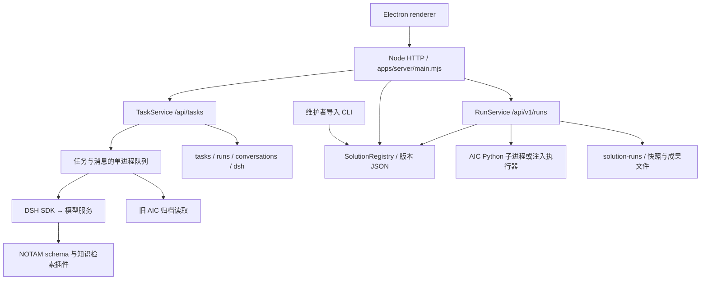

# SZH 后端架构

审查基线为 2026-11-09 本机客户端打磨版。实际运行入口是 `apps/server/main.mjs`，原生 Node HTTP 服务。新版桌面客户端在完整工程的 `apps/szh-app`，由 Electron 主进程向 renderer 注入 Harness 地址。旧 WinForms 客户端加载服务的 Web 预览，两者可调用同一个后端。

## 模块与事实来源

| 模块 | 职责 |
| --- | --- |
| `main.mjs` | HTTP 路由、请求体校验、错误封装、旧预览文件白名单。没有鉴权中间件。 |
| `tasks.mjs` | 任务、运行尝试与消息的生命周期。任务快照是旧接口的事实来源。 |
| `dsh-runner.mjs`、`task-activity.mjs` | 通过 DSH SDK 发起一轮模型调用、配置插件、接收工具与助理事件。可按 session ID 读取归档活动。 |
| `notam-profiles.mjs`、`parsing.mjs`、`report-parsing.mjs`、`notam-facts.mjs` | 选择模式、校验结构化响应和原文事实。 |
| `plugins/notam-schema.mjs`、`knowledge.mjs` | 暴露 `notam_schema`、`notam_reference`，从仓库资料索引检索。 |
| `aic-entry.mjs`、`aic-weekly-result.mjs` | 读取并核对既有 AIC 样例和实验归档，挂接允许的成果。 |
| `solution-registry.mjs`、`scripts/import-solution.mjs` | 校验 Manifest、保存不可覆盖的版本文件、列举和读取版本。 |
| `solution-runs.mjs` | 创建 Run、执行串行队列、调用执行器、生成 Artifact 元数据。 |

## 旧任务与 Agent

NOTAM 创建后进入 `awaiting_confirmation`。确认后入队，与对话消息共享一个单进程队列。执行器以 SDK profile 新建 DSH 会话，设置模型、任务提示和专业插件。NOTAM 首轮要求两个专业工具实际返回，然后校验 JSON、字段和原文约束。检查通过后仍为待专业复核。默认模型限时 180 秒，可在 10–300 秒间设置。超时或用户停止通过 SDK close 触发；任务层可从已有响应检查点继续。

通用对话创建 `ready` 类型的 Task 并发送首条消息。后续消息会携带已完成问答和当前任务上下文。代码不复用既有 DSH 进程作为长期对话会话。旧 AIC 入口在同一任务队列内装配资料，`runtime_executed` 表示归档装配执行过，`model_called` 仍为 false。

## 新版 Solution、Run、Artifact

- 维护者 CLI 将 Manifest 按 `id@version.json` 写入版本目录。启动时不会自动导入。输入输出 Schema 在注册时检查可编译性，执行时仅校验输入。版本记录含 Manifest 快照，模型包没有随版本自动锁定。
- Run 绑定明确版本和配置。进程内提交序列检查请求编号与指纹，执行另有一条串行队列，与旧任务队列独立。Run 调用已配置执行器，成功后遍历输出目录并登记文件。AIC 适配器以固定脚本和参数在 Harness 所在机器调用 Python，支持打包工况推理及一致性复核。
- Artifact 无独立数据库。元数据嵌入 Run，下载由 Run ID 与 Artifact ID 查找文件。旧 Task 文件下载走另一条路由，按尝试 ID 和允许的文件名读取。
- Run 保存使用临时文件重命名。服务启动把遗留的 queued、running、cancel_requested 标为 failed。没有跨进程锁、心跳、自动重试或通用远程调度。

## 数据目录

默认以项目根目录 `var/` 为数据根。嵌入式服务可通过 `TaskService.open({ directory })` 使用独立根目录，Registry、Run、Task、消息产物及 DSH 会话随目录隔离。配置来源仍见 README。

| 相对目录 | 内容 |
| --- | --- |
| `tasks/<id>.json` | 旧任务及消息快照，含原文、模型结果和状态 |
| `runs/<attemptId>/` | 旧任务输入、模型收据、检查和结果 |
| `conversations/<taskId>/<messageId>/` | 单轮模型运行补丁和收据 |
| `dsh/` | SDK 会话、活动归档和运行状态 |
| `solution-versions/` | 发布的版本记录 |
| `solution-runs/<id>.json`、`solution-runs/<id>/` | 新版 Run 快照与输出文件 |

这些目录会包含真实用户数据或生成结果。代码仓库和运行数据应独立备份、授权和部署。
